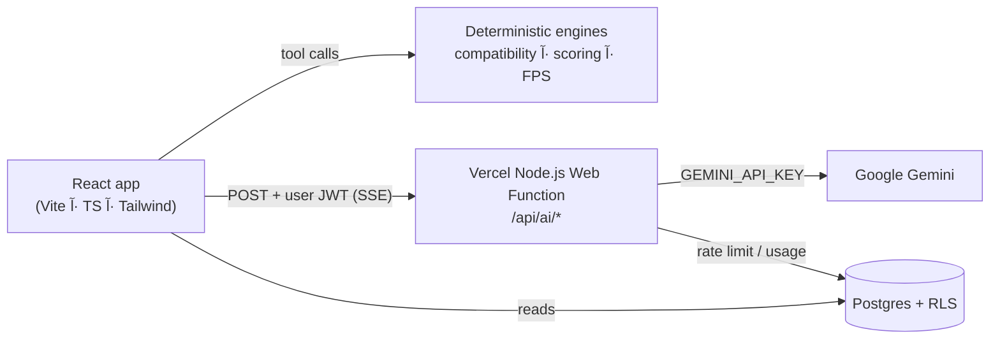

# Nexus — AI-Powered PC Builder

A production-grade web platform for designing, optimising and comparing custom PC
builds, with a compatibility engine and Google Gemini advice.

**Phase 2 (this repository state) turns the shell into a real intelligent builder:**

- A **server-side Gemini proxy** (Vercel Web Function) — validates Supabase sessions, applies a persistent per-user quota, and never exposes the API key
- A **deterministic compatibility engine**, **build score** and **FPS estimator**, all unit-tested (79 tests, >80 % coverage)
- A **Smart Builder** agent that can only pick parts it fetched from the catalogue (no hallucinated IDs)
- A **streaming AI advisor** with build context and citation chips
- A **Build Doctor** with grounded, ranked upgrade suggestions
- Real **auth, saving, sharing, community ratings and alerts**

Phase 1 delivered the architecture, schema, design system and page scaffolding.

---

## Stack

| Layer       | Choice                                                                                                            |
| ----------- | ----------------------------------------------------------------------------------------------------------------- |
| App         | React 18 آ· Vite 5 آ· TypeScript (strict)                                                                           |
| Styling     | Tailwind CSS 3 آ· class-variance-authority آ· tailwind-merge آ· clsx                                                 |
| Primitives  | shadcn/ui pattern on Radix (button, card, input, badge, dialog, select, tabs, tooltip, dropdown, skeleton, label) |
| Motion      | framer-motion 11                                                                                                  |
| State       | zustand + immer + persist                                                                                         |
| Data        | @tanstack/react-query 5                                                                                           |
| Routing     | react-router-dom 6 (lazy routes, animated transitions)                                                            |
| Forms       | react-hook-form + zod (installed, contracts ready)                                                                |
| Backend     | Supabase (Postgres آ· Auth آ· RLS)                                                                                  |
| AI          | Google Gemini via a same-origin Vercel Web Function (Supabase JWT + database quota)                                                |
| Testing     | Vitest 2 + v8 coverage (engine layers)                                                                            |
| Markdown    | react-markdown + remark-gfm (chat rendering)                                                                      |
| Toasts      | sonner                                                                                                            |
| Type / mono | Inter Variable آ· JetBrains Mono (via `@fontsource`)                                                               |

## Prerequisites

- Node **18+** (20/22 recommended)
- **pnpm** (`npm i -g pnpm`) — npm works too, but the lockfile is pnpm’s
- Optional: Supabase CLI (`brew install supabase/tap/supabase`, or `scoop install supabase`)

## Setup

```bash
git clone <repo-url> nexus-pc-builder
cd nexus-pc-builder
pnpm install

cp .env.example .env.local   # then fill in the values (optional for UI-only work)
pnpm dev                     # http://localhost:5173
```

The UI can start without Supabase credentials, but authentication, cloud saves,
community publishing, database-backed prices and production AI access require
a configured Supabase project. The product snapshot remains available as a
read-only fallback.

### Environment

| Variable | Where | Required | Purpose |
| --- | --- | --- | --- |
| `VITE_SUPABASE_URL` | `.env.local` + Vercel build env | persistence/auth | Public Supabase project URL |
| `VITE_SUPABASE_ANON_KEY` | `.env.local` + Vercel build env | persistence/auth | Public anon key; safe for the browser under RLS |
| `VITE_APP_URL` | `.env.local` + Vercel build env | deployment | Public base URL for share links and auth redirects |
| `GEMINI_API_KEY` | **Vercel server environment** | AI features | Google AI Studio key; never use a `VITE_` prefix |
| `SUPABASE_URL` | **Vercel server environment** | AI auth | Supabase project URL used by the server to validate sessions |
| `SUPABASE_ANON_KEY` | **Vercel server environment** | AI guest/account quota RPC | Public anon key used by server-side quota RPCs |
| `AI_RATE_LIMIT_SALT` | **Vercel server environment** | Guest AI quota | Random server-only salt used to hash guest IPs |

**Guest access and username accounts**

- AI, Smart Builder, catalogue browsing, search and comparison work without signing in.
- Guests receive 30 AI HTTP calls/minute per hashed client IP; verified account sessions receive 60/minute. Google AI Studio project quotas still apply separately.
- The optional account uses username + password only. Usernames are mapped to a non-deliverable `@accounts.nexus.invalid` alias for Supabase Auth. Disable **Authentication → Providers → Email → Confirm email** in the Supabase project before enabling new username registrations. There is no email-based password recovery in this mode.

> There is **no** `VITE_GEMINI_API_KEY` or service-role key in the AI proxy. The
> browser receives only the Supabase anon key. Gemini is available without login:
> guests receive 30 requests/minute per hashed IP and verified accounts receive 60/minute.

## Database

```bash
supabase start        # local Postgres + Studio + Auth
supabase db reset     # migrations 001 → 005 + seed.sql (32 components, 12 rules, 3 builds, 120 benchmarks)
```

Hosted project:

```bash
supabase link --project-ref <ref>
supabase db push                                   # 001…005
psql "$DATABASE_URL" -f supabase/seed.sql          # or paste it in the SQL editor
```

| Migration | Contents |
| --- | --- |
| `001_initial_schema.sql` | Core tables, triggers, indexes and RLS |
| `002_catalogue_rls.sql` | Role-scoped catalogue writes |
| `003_1_performance_data.sql` | `fps_benchmarks`, `ai_fps_estimates`, `ai_usage` |
| `003_2_fps_benchmarks_seed.sql` | Seed FPS benchmark measurements |
| `004_chat.sql` | `chat_sessions`, `chat_messages` |
| `005_ratings.sql` | `build_ratings` and rating/view triggers |
| `006_fix_storage_rule.sql` | Storage policy corrections |
| `007_i18n_content.sql` | Localized catalogue/content fields |
| `008_retailer_products.sql` | Retailer product prices, sync runs and indexes |
| `009_retailer_cron.sql` | Optional daily `retailer-sync` pg_cron schedule |
| `010_price_units.sql` | Price-unit normalization |
| `011_atomic_ai_usage_quota.sql` | Atomic per-user AI rate limiting for Vercel

Full schema, ER diagram, spec contract and RLS matrix: **[docs/DATABASE.md](docs/DATABASE.md)**.

Production environment, AI proxy deployment, retailer sync and GitHub Actions setup: **[docs/PRODUCTION_REPAIR_AR.md](docs/PRODUCTION_REPAIR_AR.md)**.

## AI setup

The browser calls `/api/ai/*`; the deployed Vercel Web Function validates
its Supabase access token and consumes a database-backed quota before forwarding
the request to Google. Configure these values in **Vercel → Project → Settings
→ Environment Variables** for Production, Preview and Development:

```env
GEMINI_API_KEY=your-google-ai-studio-key
SUPABASE_URL=https://your-project.supabase.co
SUPABASE_ANON_KEY=your-supabase-anon-key
VITE_SUPABASE_URL=https://your-project.supabase.co
VITE_SUPABASE_ANON_KEY=your-public-anon-key
```

Apply migrations `011_atomic_ai_usage_quota.sql`, `013_authenticated_ai_quota.sql`,
and `014_guest_ai_quota.sql` before enabling the AI route, then redeploy. The
Vercel proxy uses an atomic guest-IP quota when no account token is supplied and
a per-account quota for signed-in users. AI login is optional. Local Vite development
can use `GEMINI_API_KEY` without the production quota gate.
The standalone Supabase Edge Function in `supabase/functions/gemini-proxy` is
kept as an alternate/legacy endpoint; the current browser provider uses the
Vercel route so Gemini's tool-call signatures and grounding metadata remain
intact. See **[docs/AI_ARCHITECTURE.md](docs/AI_ARCHITECTURE.md)**.

## Deployment

This is a **client-side SPA**: `/search`, `/builder/ai` and `/compare/:id` exist
only in the React router, not as files on disk. A static host must therefore
serve `index.html` for any path it cannot resolve, or a hard refresh on a
sub-route returns **404**.

Fallbacks are committed for every common host:

| Host | File | Behaviour |
| --- | --- | --- |
| **Vercel** | `vercel.json` | rewrites everything except `/api/*` to `index.html` |
| **Netlify** | `public/_redirects` | `/*  /index.html  200` (a rewrite, not a redirect) |
| **Cloudflare Pages** | `public/_routes.json` | SPA rewrite rule |
| **Apache / cPanel** | `public/.htaccess` | `mod_rewrite` fallback |
| **GitHub Pages** | — | needs a host-level fallback; prefer one of the above |

`public/` is copied verbatim into `dist/`, so no extra build step is needed.

### Steps

1. **Build**
   ```bash
   pnpm build        # -> dist/
   ```
2. **Set the public URL** in the host's environment before building, so share
   links point at the real domain:
   ```
   VITE_APP_URL=https://your-domain.com
   ```
   This is inlined at build time — a change requires a rebuild.
   For Vercel AI, also set `GEMINI_API_KEY`, `SUPABASE_URL` and
   `SUPABASE_ANON_KEY` (or `VITE_SUPABASE_ANON_KEY`) as an environment variable,
   apply migrations `011_atomic_ai_usage_quota.sql`,
   `013_authenticated_ai_quota.sql` and `014_guest_ai_quota.sql`, then redeploy.
3. **Deploy** `dist/` to the host. Publish directory is `dist`, build command
   `pnpm build`.
4. **Verify** the fix — open `/search` directly and refresh the page. It must
   render the app, not a 404:
   ```bash
   pnpm verify:spa
   ```

### Why the 404 happened

Without a rewrite, requesting `/search` asks the host for a file at that path.
There is none, so the host answers 404 — even though the app handles the route
perfectly once `index.html` is served. The rewrite maps unknown paths to the
shell and lets the router take over; the browser keeps the real URL.

### The exception that broke the API — twice

**Attempt 1 (Phase 14):** a catch-all rewrite also owns `/api/*`, and Vercel
applies rewrites **before** it matches a Serverless Function — so
`/api/ai/config` was answered with the SPA shell. Fixed with a negative lookahead.

**Attempt 2 (Phase 15):** still 404 in production. Measuring the live deployment
showed why the rewrite alone was not enough:

```
/api/ai/config        → 404 with OUR JSON  (handler ran, route resolved empty)
/api/ai/missing       → 404 with OUR JSON  (handler ran)
/api/ai/v1beta/…      → 404, EMPTY body    (never reached a handler)
```

The generated routing table is the cause:

```json
{ "src": "^/api/ai(/.*)?$",   "dest": "/api/ai/[...path]", "check": true }
{ "src": "^/api/ai/([^/]+)$", "dest": "/api/ai/[...path]?path=$1" }
{ "src": "^/api(/.*)?$",       "status": 404 }
```

The prefix rule — the only one that could serve any depth — is emitted with
`"check": true`, so it fires only when that literal path exists on disk. It never
does. The `[^/]+` rule then serves **exactly one segment**, and every real Gemini
call (four segments) falls into the `/api` 404 guard.

**The routing fix:** `middleware.ts` owns `/api/ai/*` and rewrites every request to
`/api/ai?path=<rest>`. A middleware is a `continue` route with no filesystem check,
so it runs at any depth. The function itself now uses Vercel's documented
`export default { fetch(request: Request) { ... } }` Web Standard entry point,
not a Node `(req, res)` default mixed with named Web handlers. The handler also
validates the Supabase user token, checks the atomic AI quota and rejects
unsupported model routes before forwarding requests.
`vercel.json` keeps exactly two rewrites:

```json
"rewrites": [
  { "source": "/((?!api/).*)", "destination": "/index.html" },
  { "source": "/api/ai(/.*)?", "destination": "/api/ai/[...path]" }
]
```

There is **no** `/api/(.*)` rewrite: Vercel discovers `api/` itself, and a blanket
API rewrite would replace that discovery instead of complementing it.

```bash
node scripts/verify-api-route.mjs        # executes the built artifacts, 3 depths
node scripts/verify-vercel-routing.mjs   # replays the built routing table
```

Both are in `audit:all`. The first runs the emitted middleware on a request, feeds
its rewrite target to the emitted function, and **fails on a 404** at any depth —
which is precisely the bug that shipped twice.

## Scripts

| Script | Description |
| --- | --- |
| `pnpm dev` | Vite dev server |
| `pnpm build` | Type-check (`tsc -b`) then production build |
| `pnpm preview` | Serve the production build |
| `pnpm lint` | ESLint (0 errors / 0 warnings expected) |
| `pnpm format` | Prettier |
| `pnpm audit:all` | Full gate (24 checks): types, lint, i18n, RTL, design system, hardcoded strings, build, secrets, SPA routing, dead code, **catalogue categories**, **catalogue specs**, **Vercel routing**, **API route**, tests |
| `pnpm verify:spa` | Prove sub-routes survive a hard refresh |
| `node scripts/verify-api-route.mjs` | Execute the BUILT middleware + function at depth 1, 2 and 4 — the check that would have caught "one segment works, deeper 404s" |
| `node scripts/verify-vercel-routing.mjs` | Replay the BUILT `.vercel/output/config.json` — proves `/api/ai` reaches the middleware at every depth and SPA paths still fall back |
| `node scripts/reclassify-catalogue.mjs` | Re-derive every listing's category from its URL, title and page (`--dry-run` to preview) |
| `node scripts/enrich-specs.mjs` | Infer sockets, VRAM, TDP, lengths, wattages for the whole snapshot |
| `node scripts/verify-catalogue-categories.mjs` | Fail if a fan is in CPUs or a case in GPUs |
| `node scripts/verify-catalogue-specs.mjs` | Fail if a bucket is missing the spec its compatibility rule reads |
| `node scripts/measure-grouping.mjs` | Cross-store groups vs. over-merged groups, on the real catalogue |
| `pnpm audit:mobile` | Overflow + 44px tap targets at 375/390/414/768 |
| `pnpm crawl` | Re-scrape retailer prices into the offline snapshot |
| `pnpm typecheck` | `tsc -p tsconfig.app.json --noEmit` |
| `pnpm test` | Vitest — engine unit tests |
| `pnpm test:coverage` | Coverage (80 % gate on the engine folders) |
| `pnpm test:ui` | Vitest UI |
| `pnpm functions:serve` / `functions:deploy` | Legacy Supabase Gemini proxy (not used by the browser provider) |
| `pnpm db:push` / `pnpm db:reset` | Supabase CLI shortcuts |

## Data: where the parts come from

The catalogue is built from actual product listings captured from the connected
Egyptian retailers. When Supabase is configured, `retailer_products` is the
authoritative source and the `retailer-sync` Edge Function refreshes it. The
committed JSON snapshots keep the catalogue available before the first sync and
when the database is unavailable; snapshots are captures, **not a guarantee of
real-time prices**. Each capture includes a `capturedAt` timestamp. The Sigma
worker is refreshed by the scheduled GitHub Actions workflow in
`.github/workflows/sigma-feed.yml`.

```
retailer_products / public/data/retailer_snapshot.json
  → aggregator      category from the store's URL collection, specs inferred from the model
  → groupListings   one entry per SKU — the cheapest in-stock offer wins
  → buildCatalogue  PCComponent + store links + relative performance tier
  → useComponents   the single catalogue reader for the whole app
```

| Concern | Where it lives |
| --- | --- |
| Which bucket a listing belongs to | `lib/categoryRules.ts` (read time) · `scripts/reclassify-catalogue.mjs` (snapshot) · `supabase/functions/retailer-sync/parsers.ts` (write time) |
| Missing technical specs (socket, VRAM, TDP, length, wattage) | `lib/specInference.ts` — inferred from the chip, marked `high` or `estimated` |
| Relative performance (no benchmarks exist) | `lib/performanceTier.ts`, labelled as an estimate in the UI |
| One card per product across shops | `lib/skuGrouping.ts` + `groupListings`, measured by `scripts/measure-grouping.mjs` |
| Compatibility | `lib/compatibility/engine.ts` — unchanged, now fed real specs |

Because specs are inferred, the compatibility engine can disagree with reality at
the margins: a card length is a board-partner estimate, not a published figure.
The UI says so (`builder.specs.estimatedScore`) rather than implying certainty.

## Architecture



The browser owns the agent loop and runs deterministic engines; the Vercel
proxy validates each signed-in user, consumes the database quota and holds the
only copy of the Gemini API key.
Full detail: **[docs/AI_ARCHITECTURE.md](docs/AI_ARCHITECTURE.md)**.

## Documentation

| Doc | Contents |
| --- | --- |
| [docs/AI_ARCHITECTURE.md](docs/AI_ARCHITECTURE.md) | Agent loop, tools, models, cost controls, fallbacks |
| [docs/COMPATIBILITY_RULES.md](docs/COMPATIBILITY_RULES.md) | Every rule type + how to add one |
| [docs/DATABASE.md](docs/DATABASE.md) | ER diagram, tables, RLS matrix |
| [docs/PHASE2_QA.md](docs/PHASE2_QA.md) | End-to-end checklist |
| [supabase/functions/gemini-proxy/README.md](supabase/functions/gemini-proxy/README.md) | Proxy API contract |

## Folder structure

```
src/
├── components/
│   ├── ui/          # shadcn primitives on Radix
│   ├── layout/      # AppShell, Sidebar, Topbar, PageHeader, Logo
│   ├── shared/      # PageTransition, AnimatedNumber, GradientMesh, EmptyState,
│   │                # LoadingSkeleton, ErrorBoundary, PriceTag
│   └── domain/      # ComponentCard, BuildCard, BuildScoreRing, BuildSummaryPanel,
│                    # CompatibilityBadge, CategoryIcon
├── pages/           # Landing, Builder, AIAdvisor, PrebuiltConfigs, Community,
│                    # Dashboard, BuildDetail, NotFound
├── services/        # supabaseClient, componentsService, geminiService (stub)
├── store/           # useBuildStore (persist), useUIStore (theme/sidebar)
├── hooks/           # useComponents (react-query), useMediaQuery
├── types/           # components, build, ai, database (generated-style)
├── lib/             # utils, motion, constants, navigation, sampleData
├── styles/globals.css
├── router.tsx  App.tsx  main.tsx
supabase/            # config.toml, migrations/, seed.sql
docs/DATABASE.md
```

## Routes

| Path | Page |
| --- | --- |
| `/` | Landing — animated hero, features, how-it-works, CTA |
| `/builder` | Manual builder: live compatibility banner, category rail with counts, component grid, sticky summary with real score + budget meter |
| `/builder/ai` | **Smart Builder** — 4-step wizard → agentic generation → review & save |
| `/ai-advisor` | **Streaming advisor** with build context, citations, cancel |
| `/auth` | Optional username + password account; continue as guest |
| `/dashboard/builds/:slug/doctor` | **Build Doctor** — grounded diagnosis + ranked upgrades |
| `/prebuilt` | Filter tabs (`layoutId` indicator) + build cards |
| `/community` | Feed of published builds + trending tags |
| `/dashboard` | Stat cards with count-up, in-progress build, saved grid |
| `/b/:slug` | Shareable build detail (public, RLS-friendly) |
| `*` | Glitch 404 |

## Design system — “Nexusâ€‌

**Tokens** live in `src/styles/globals.css` as RGB triplets so Tailwind can
compose alpha (`rgb(var(--primary) / 0.2)`). Dark is the default (`<html
class="dark">`); light mode mirrors the palette under `.light`. Theme is applied
before first paint by an inline script in `index.html` to avoid a flash.

| Token          | Dark      | Light     |
| -------------- | --------- | --------- |
| `--background` | `#08090C` | `#F8F9FC` |
| `--surface`    | `#0F1117` | `#FFFFFF` |
| `--primary`    | `#6366F1` | `#4F52DD` |
| `--secondary`  | `#8B5CF6` | `#7C3AED` |
| `--accent`     | `#22D3EE` | `#0891B2` |

**Utilities:** `.glass`, `.glass-strong`, `.grid-overlay`, `.text-gradient`,
`.border-gradient`, `.shimmer`, `.tabular`.

**Motion presets** (`src/lib/motion.ts`): `fadeIn`, `fadeUp`, `fadeDown`,
`scaleIn`, `slideInLeft/Right`, `staggerContainer`/`staggerItem`,
`pageTransition`, `hoverLift`, `spring`, `modalMotion`, `viewportOnce`.

**Motion rules:** 200–400 ms, ease-out (`[0.22, 1, 0.36, 1]`) or spring, no
bounce. Every animation degrades gracefully under `prefers-reduced-motion` —
globally via the media query in `globals.css` and per-component via
`useReducedMotion` / `<MotionConfig reducedMotion="user">`.

**Loading:** shimmer skeletons only (`<Skeleton>`, `<LoadingSkeleton>`), never
spinners.

## Accessibility

- Visible focus rings on all interactive elements
- `aria-label`s on icon-only controls, `aria-current` on nav
- `prefers-reduced-motion` respected (CSS + Framer)
- Colour is never the only signal (icons accompany compatibility states)

## Phase 3 readiness

What is real now: secure AI proxy, deterministic engines, agentic build
generation with a no-hallucination guarantee, streaming chat, Build Doctor,
auth, saving, publishing, ratings and alerts.

Still missing versus the original brief, recommended for Phase 3:

| Gap | Suggested scope |
| --- | --- |
| Price ingestion | Scraper/Price API → `components.price` + `store_links`; keep `price_at_add` immutable |
| Alert scheduler | `pg_cron` job comparing prices → `saved_alerts.triggered_at` + push/email |
| Community pagination | Cursor pagination on `published_at`, infinite scroll |
| Images | Supabase Storage bucket + `image_url`; cards fall back to glyphs today |
| Build comments | `build_comments` table, threaded, RLS by author |
| Advisor sessions UI | `chat_sessions`/`chat_messages` are provisioned; the sidebar/history list is not yet rendered |
| Offers & stock | Real availability from retailers instead of the seeded `stock_status` |
| E2E tests | Playwright suite over the flows in `docs/PHASE2_QA.md` |

## Known limitations (Phase 2)

- Source code and migrations are included, but this archive cannot verify the
  state of your hosted Supabase/Vercel projects. Apply the migrations and deploy
  `retailer-sync` before relying on the database-backed live catalogue. See
  `docs/PRODUCTION_REPAIR.md` for the exact production checklist.
- `vitest` is pinned to v2; v5 requires Vite 6 and the app is on Vite 5.
- The live `ai_fps_estimates` / `chat_*` tables are only used once deployed; the
  advisor works without session history in the meantime.
- Component images are `null` — cards use category glyphs and gradients.

> Historical note: the Phase 1 seed paired a 750 W PSU with a GPU that needs
> 805 W under the headroom rule. The engine's real-data test caught it and the
> seed now uses the 850 W RM850x.

---

## Deployment on Vercel

Vercel runs two things side by side: the static SPA and the Serverless Function in
`api/`. They fail differently, so each has its own check.

### 1. Add the AI key (server-side only)

> ## ⚠️ Never use `VITE_GEMINI_API_KEY`
>
> The name **must** be `GEMINI_API_KEY`, with **no `VITE_` prefix**.
>
> Vite replaces every `import.meta.env.VITE_*` at BUILD TIME with the literal
> value, so `VITE_GEMINI_API_KEY` is written into the JavaScript every visitor
> downloads. It is readable in DevTools, in the CDN cache, and in any archived
> copy of the bundle — and because it is inlined, rotating the key in Vercel has
> no effect on an already-built deployment. Google bills the account either way.
>
> A key exposed in a client bundle is **compromised**, not just misconfigured.
> Revoke it in Google AI Studio and issue a new one.
>
> `pnpm check:secrets` fails the build if any `VITE_*` variable looks like a key,
> and the app never reads a Gemini key in the browser: it calls `/api/ai/*` and
> the Serverless Function reads `process.env.GEMINI_API_KEY`.

1. **Vercel → your project → Settings → Environment Variables**
2. Add **`GEMINI_API_KEY`** = your key from
   [Google AI Studio](https://aistudio.google.com/app/apikey)
3. Tick **Production**, **Preview** *and* **Development**. A key set only on
   Production leaves preview deploys answering `{ "ok": false }`.
4. **Redeploy.** Environment variables are bound when a deployment is built —
   an existing deployment does not pick up a newly added value.

Optional: `GEMINI_MODEL` is displayed in deployment diagnostics. Interactive routing uses Gemini 3.5 Flash-Lite with MINIMAL thinking and streaming; fallback models are attempted only for Google upstream model errors. The model supports up to 1,048,576 input tokens and 65,536 output tokens, subject to project quotas and the application response cap.

#### Verify

```bash
curl -s https://<your-app>.vercel.app/api/ai/config
```

| Response | Meaning |
| --- | --- |
| `{ "ok": true, "gemini": true, "model": … }` | AI is live |
| `{ "ok": false, … "hint": "…" }` | Deploy is fine, the key is missing — the `hint` names the fix |
| **404** | `api/ai` is not deployed, or a rewrite is swallowing `/api/*` |

`pnpm verify:ai-route` performs the same checks locally against the real function
module, so a deploy is not needed to test it.

### 2. Database (required for production auth, cloud data and retailer sync)

```bash
supabase db push
```

Until the hosted migrations and retailer sync are active, the app reads the
committed catalogue (`public/data/retailer_snapshot.json`) and Sigma snapshot.
That is a useful fallback, but prices may be stale. If `retailer_products`
exists but returns `401 42501`, grant read access once:

```sql
grant select on public.retailer_products to anon, authenticated;
```

### 3. Retailer images

Product photos are hotlinked from each store. **Elnekhely answers 403 to any
image request that carries a foreign `Referer`** (and 200 when none is sent), so
every retailer `` sets `referrerPolicy="no-referrer"`. A regression test
(`src/components/retail/__tests__/imageReferrer.test.ts`) fails the build if a new
image tag forgets it.

### Common production failures

| Symptom | Cause | Fix |
| --- | --- | --- |
| **`500 FUNCTION_INVOCATION_FAILED`** | the function threw at **module load** — most often an import that does not resolve in the emitted bundle | run `pnpm verify:ai-route-bundle`; write local imports **without** a file extension |
| `/api/ai/config` → 404 | `api/` not deployed, or `/api/*` caught by the SPA rewrite | check `vercel.json` (`/((?!api/).*)`) and the build output |
| config → `ok: false` | key missing for this environment | add it to all three environments and redeploy |
| AI answers 401 | invalid/expired optional account token | sign out or refresh the session; guest AI remains available |
| AI answers 503 | server variables or quota migrations are missing | set `SUPABASE_URL`, `SUPABASE_ANON_KEY`, `AI_RATE_LIMIT_SALT`; apply migrations 013 and 014, then redeploy |
| hard refresh on `/search` → 404 | SPA rewrite missing on the host | see the host table above |
| broken product images | Referer-blocked hotlink | `referrerPolicy="no-referrer"` (already applied) |
