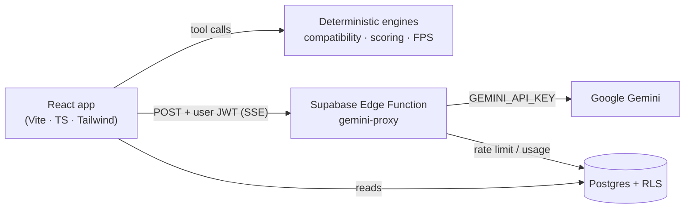

# Nexus — AI-Powered PC Builder

A production-grade web platform for designing, optimising and comparing custom PC
builds, with a compatibility engine and Google Gemini advice.

**Phase 2 (this repository state) turns the shell into a real intelligent builder:**

- A **secure Gemini proxy** (Supabase Edge Function) — the API key never reaches the browser
- A **deterministic compatibility engine**, **build score** and **FPS estimator**, all unit-tested (79 tests, >80 % coverage)
- A **Smart Builder** agent that can only pick parts it fetched from the catalogue (no hallucinated IDs)
- A **streaming AI advisor** with build context and citation chips
- A **Build Doctor** with grounded, ranked upgrade suggestions
- Real **auth, saving, sharing, community ratings and alerts**

Phase 1 delivered the architecture, schema, design system and page scaffolding.

---

## Stack

| Layer       | Choice                                                                                                            |
| ----------- | ----------------------------------------------------------------------------------------------------------------- |
| App         | React 18 · Vite 5 · TypeScript (strict)                                                                           |
| Styling     | Tailwind CSS 3 · class-variance-authority · tailwind-merge · clsx                                                 |
| Primitives  | shadcn/ui pattern on Radix (button, card, input, badge, dialog, select, tabs, tooltip, dropdown, skeleton, label) |
| Motion      | framer-motion 11                                                                                                  |
| State       | zustand + immer + persist                                                                                         |
| Data        | @tanstack/react-query 5                                                                                           |
| Routing     | react-router-dom 6 (lazy routes, animated transitions)                                                            |
| Forms       | react-hook-form + zod (installed, contracts ready)                                                                |
| Backend     | Supabase (Postgres · Auth · RLS)                                                                                  |
| AI          | Google Gemini via a Supabase Edge Function (key stays server-side)                                                |
| Testing     | Vitest 2 + v8 coverage (engine layers)                                                                            |
| Markdown    | react-markdown + remark-gfm (chat rendering)                                                                      |
| Toasts      | sonner                                                                                                            |
| Type / mono | Inter Variable · JetBrains Mono (via `@fontsource`)                                                               |

## Prerequisites

- Node **18+** (20/22 recommended)
- **pnpm** (`npm i -g pnpm`) — npm works too, but the lockfile is pnpm’s
- Optional: Supabase CLI (`brew install supabase/tap/supabase`, or `scoop install supabase`)

## Setup

```bash
git clone <repo-url> nexus-pc-builder
cd nexus-pc-builder
pnpm install

cp .env.example .env.local   # then fill in the values (optional for UI-only work)
pnpm dev                     # http://localhost:5173
```

The app runs **without** Supabase credentials: components fall back to the
offline demo catalogue in `src/lib/sampleData.ts`, so every page is navigable on
a fresh clone. Add the env vars and the same hooks switch to live rows.

### Environment

| Variable | Where | Required | Purpose |
| --- | --- | --- | --- |
| `VITE_SUPABASE_URL` | `.env.local` | persistence/auth | Supabase project URL |
| `VITE_SUPABASE_ANON_KEY` | `.env.local` | persistence/auth | Public anon key |
| `VITE_APP_URL` | `.env.local` | deployment | Public base URL for share links and auth redirects. Leave empty locally; set it to the deployed origin. |
| `GEMINI_API_KEY` | **Supabase secret** | AI features | Google AI Studio key |

> There is **no** `VITE_GEMINI_API_KEY`. A `VITE_` variable is inlined into the
> browser bundle, which would hand the key to every visitor. It is read only by
> the Edge Function via `Deno.env.get('GEMINI_API_KEY')`.

## Database

```bash
supabase start        # local Postgres + Studio + Auth
supabase db reset     # migrations 001 → 005 + seed.sql (32 components, 12 rules, 3 builds, 120 benchmarks)
```

Hosted project:

```bash
supabase link --project-ref <ref>
supabase db push                                   # 001…005
psql "$DATABASE_URL" -f supabase/seed.sql          # or paste it in the SQL editor
```

| Migration | Contents |
| --- | --- |
| `001_initial_schema.sql` | enum, 6 tables, triggers, indexes, RLS |
| `002_catalogue_rls.sql` | role-scoped catalogue writes |
| `003_1_performance_data.sql` | `fps_benchmarks`, `ai_fps_estimates`, `ai_usage` |
| `003_2_fps_benchmarks_seed.sql` | 120 benchmark rows (10 games × 4 GPUs × 3 resolutions) |
| `004_chat.sql` | `chat_sessions`, `chat_messages` |
| `005_ratings.sql` | `build_ratings` + rating/view triggers |

Full schema, ER diagram, spec contract and RLS matrix: **[docs/DATABASE.md](docs/DATABASE.md)**.

## AI setup

```bash
supabase secrets set GEMINI_API_KEY=AQ.xxxxxxxx
supabase functions deploy gemini-proxy

# local development:
cp supabase/.env.local.example supabase/.env.local   # then fill in GEMINI_API_KEY
pnpm functions:serve
```

The proxy enforces a 20 req/min per-user limit (`ai_usage`), a model allow-list,
a 45 s timeout and one retry with backoff. See
**[docs/AI_ARCHITECTURE.md](docs/AI_ARCHITECTURE.md)** and
`supabase/functions/gemini-proxy/README.md`.

## Deployment

This is a **client-side SPA**: `/search`, `/builder/ai` and `/compare/:id` exist
only in the React router, not as files on disk. A static host must therefore
serve `index.html` for any path it cannot resolve, or a hard refresh on a
sub-route returns **404**.

Fallbacks are committed for every common host:

| Host | File | Behaviour |
| --- | --- | --- |
| **Vercel** | `vercel.json` | rewrites everything except `/api/*` to `index.html` |
| **Netlify** | `public/_redirects` | `/*  /index.html  200` (a rewrite, not a redirect) |
| **Cloudflare Pages** | `public/_routes.json` | SPA rewrite rule |
| **Apache / cPanel** | `public/.htaccess` | `mod_rewrite` fallback |
| **GitHub Pages** | — | needs a host-level fallback; prefer one of the above |

`public/` is copied verbatim into `dist/`, so no extra build step is needed.

### Steps

1. **Build**
   ```bash
   pnpm build        # -> dist/
   ```
2. **Set the public URL** in the host's environment before building, so share
   links point at the real domain:
   ```
   VITE_APP_URL=https://your-domain.com
   ```
   This is inlined at build time — a change requires a rebuild.
3. **Deploy** `dist/` to the host. Publish directory is `dist`, build command
   `pnpm build`.
4. **Verify** the fix — open `/search` directly and refresh the page. It must
   render the app, not a 404:
   ```bash
   pnpm verify:spa
   ```

### Why the 404 happened

Without a rewrite, requesting `/search` asks the host for a file at that path.
There is none, so the host answers 404 — even though the app handles the route
perfectly once `index.html` is served. The rewrite maps unknown paths to the
shell and lets the router take over; the browser keeps the real URL.

## Scripts

| Script | Description |
| --- | --- |
| `pnpm dev` | Vite dev server |
| `pnpm build` | Type-check (`tsc -b`) then production build |
| `pnpm preview` | Serve the production build |
| `pnpm lint` | ESLint (0 errors / 0 warnings expected) |
| `pnpm format` | Prettier |
| `pnpm audit:all` | Full gate: types, lint, i18n, RTL, design system, hardcoded strings, build, secrets, SPA routing, dead code, tests |
| `pnpm verify:spa` | Prove sub-routes survive a hard refresh |
| `pnpm audit:mobile` | Overflow + 44px tap targets at 375/390/414/768 |
| `pnpm snapshot:retailers` | Re-scrape retailer prices into the offline snapshot |
| `pnpm typecheck` | `tsc -p tsconfig.app.json --noEmit` |
| `pnpm test` | Vitest — engine unit tests |
| `pnpm test:coverage` | Coverage (80 % gate on the engine folders) |
| `pnpm test:ui` | Vitest UI |
| `pnpm functions:serve` / `functions:deploy` | Gemini proxy |
| `pnpm db:push` / `pnpm db:reset` | Supabase CLI shortcuts |

## Architecture



The browser owns the agent loop and runs the engines; the proxy is a stateless,
rate-limited transport that holds the only copy of the API key.
Full detail: **[docs/AI_ARCHITECTURE.md](docs/AI_ARCHITECTURE.md)**.

## Documentation

| Doc | Contents |
| --- | --- |
| [docs/AI_ARCHITECTURE.md](docs/AI_ARCHITECTURE.md) | Agent loop, tools, models, cost controls, fallbacks |
| [docs/COMPATIBILITY_RULES.md](docs/COMPATIBILITY_RULES.md) | Every rule type + how to add one |
| [docs/DATABASE.md](docs/DATABASE.md) | ER diagram, tables, RLS matrix |
| [docs/PHASE2_QA.md](docs/PHASE2_QA.md) | End-to-end checklist |
| [supabase/functions/gemini-proxy/README.md](supabase/functions/gemini-proxy/README.md) | Proxy API contract |

## Folder structure

```
src/
├── components/
│   ├── ui/          # shadcn primitives on Radix
│   ├── layout/      # AppShell, Sidebar, Topbar, PageHeader, Logo
│   ├── shared/      # PageTransition, AnimatedNumber, GradientMesh, EmptyState,
│   │                # LoadingSkeleton, ErrorBoundary, PriceTag
│   └── domain/      # ComponentCard, BuildCard, BuildScoreRing, BuildSummaryPanel,
│                    # CompatibilityBadge, CategoryIcon
├── pages/           # Landing, Builder, AIAdvisor, PrebuiltConfigs, Community,
│                    # Dashboard, BuildDetail, NotFound
├── services/        # supabaseClient, componentsService, geminiService (stub)
├── store/           # useBuildStore (persist), useUIStore (theme/sidebar)
├── hooks/           # useComponents (react-query), useMediaQuery
├── types/           # components, build, ai, database (generated-style)
├── lib/             # utils, motion, constants, navigation, sampleData
├── styles/globals.css
├── router.tsx  App.tsx  main.tsx
supabase/            # config.toml, migrations/, seed.sql
docs/DATABASE.md
```

## Routes

| Path | Page |
| --- | --- |
| `/` | Landing — animated hero, features, how-it-works, CTA |
| `/builder` | Manual builder: live compatibility banner, category rail with counts, component grid, sticky summary with real score + budget meter |
| `/builder/ai` | **Smart Builder** — 4-step wizard → agentic generation → review & save |
| `/ai-advisor` | **Streaming advisor** with build context, citations, cancel |
| `/auth` | Passwordless magic-link sign-in |
| `/dashboard/builds/:slug/doctor` | **Build Doctor** — grounded diagnosis + ranked upgrades |
| `/prebuilt` | Filter tabs (`layoutId` indicator) + build cards |
| `/community` | Feed of published builds + trending tags |
| `/dashboard` | Stat cards with count-up, in-progress build, saved grid |
| `/b/:slug` | Shareable build detail (public, RLS-friendly) |
| `*` | Glitch 404 |

## Design system — “Nexus”

**Tokens** live in `src/styles/globals.css` as RGB triplets so Tailwind can
compose alpha (`rgb(var(--primary) / 0.2)`). Dark is the default (`<html
class="dark">`); light mode mirrors the palette under `.light`. Theme is applied
before first paint by an inline script in `index.html` to avoid a flash.

| Token          | Dark      | Light     |
| -------------- | --------- | --------- |
| `--background` | `#08090C` | `#F8F9FC` |
| `--surface`    | `#0F1117` | `#FFFFFF` |
| `--primary`    | `#6366F1` | `#4F52DD` |
| `--secondary`  | `#8B5CF6` | `#7C3AED` |
| `--accent`     | `#22D3EE` | `#0891B2` |

**Utilities:** `.glass`, `.glass-strong`, `.grid-overlay`, `.text-gradient`,
`.border-gradient`, `.shimmer`, `.tabular`.

**Motion presets** (`src/lib/motion.ts`): `fadeIn`, `fadeUp`, `fadeDown`,
`scaleIn`, `slideInLeft/Right`, `staggerContainer`/`staggerItem`,
`pageTransition`, `hoverLift`, `spring`, `modalMotion`, `viewportOnce`.

**Motion rules:** 200–400 ms, ease-out (`[0.22, 1, 0.36, 1]`) or spring, no
bounce. Every animation degrades gracefully under `prefers-reduced-motion` —
globally via the media query in `globals.css` and per-component via
`useReducedMotion` / `<MotionConfig reducedMotion="user">`.

**Loading:** shimmer skeletons only (`<Skeleton>`, `<LoadingSkeleton>`), never
spinners.

## Accessibility

- Visible focus rings on all interactive elements
- `aria-label`s on icon-only controls, `aria-current` on nav
- `prefers-reduced-motion` respected (CSS + Framer)
- Colour is never the only signal (icons accompany compatibility states)

## Phase 3 readiness

What is real now: secure AI proxy, deterministic engines, agentic build
generation with a no-hallucination guarantee, streaming chat, Build Doctor,
auth, saving, publishing, ratings and alerts.

Still missing versus the original brief, recommended for Phase 3:

| Gap | Suggested scope |
| --- | --- |
| Price ingestion | Scraper/Price API → `components.price` + `store_links`; keep `price_at_add` immutable |
| Alert scheduler | `pg_cron` job comparing prices → `saved_alerts.triggered_at` + push/email |
| Community pagination | Cursor pagination on `published_at`, infinite scroll |
| Images | Supabase Storage bucket + `image_url`; cards fall back to glyphs today |
| Build comments | `build_comments` table, threaded, RLS by author |
| Advisor sessions UI | `chat_sessions`/`chat_messages` are provisioned; the sidebar/history list is not yet rendered |
| Offers & stock | Real availability from retailers instead of the seeded `stock_status` |
| E2E tests | Playwright suite over the flows in `docs/PHASE2_QA.md` |

## Known limitations (Phase 2)

- **The Phase 2 migrations and Edge Function are written but not deployed from
  this environment** (no Docker / Supabase CLI / Deno on this machine). The app
  runs on the bundled catalogue until `supabase db push` + `functions deploy`
  are run. See `docs/PHASE2_QA.md`.
- `vitest` is pinned to v2; v5 requires Vite 6 and the app is on Vite 5.
- The live `ai_fps_estimates` / `chat_*` tables are only used once deployed; the
  advisor works without session history in the meantime.
- Component images are `null` — cards use category glyphs and gradients.

> Historical note: the Phase 1 seed paired a 750 W PSU with a GPU that needs
> 805 W under the headroom rule. The engine's real-data test caught it and the
> seed now uses the 850 W RM850x.
