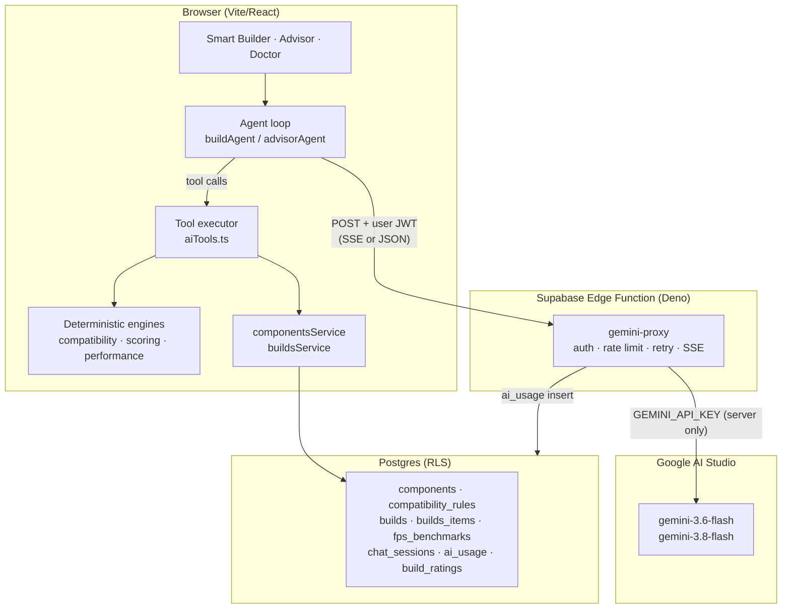

# AI Architecture — Nexus PC Builder

How the AI is wired, what it is allowed to decide, and what it must never
decide.

## The core principle: determinism where it matters

| Concern                      | Owner                                              | Why                                                                                         |
| ---------------------------- | -------------------------------------------------- | ------------------------------------------------------------------------------------------- |
| Compatibility rules          | **Deterministic engine** (`src/lib/compatibility`) | Must be reproducible and explainable; a model cannot be trusted to know a GPU's length      |
| Build score                  | **Deterministic engine** (`src/lib/scoring`)       | Used as the agent's reward signal — if it could drift, the agent could "optimise" a fiction |
| Base FPS                     | **Deterministic** (`fps_benchmarks`)               | Measured data beats guesses                                                                 |
| Component selection          | **Gemini**                                         | Genuine judgement: trade-offs, budget allocation, preferences                               |
| Reasoning & narration        | **Gemini**                                         | Explaining _why_ is what users actually read                                                |
| FPS for unbenchmarked combos | **Gemini (cached)**                                | Better than nothing, clearly labelled and cached                                            |

The model never computes a number that the engines can compute. Every tool
result it sees already contains the computed price, wattage, compatibility and
score.

## Request flow



**The key never reaches the browser.** `/env.example` no longer has
`VITE_GEMINI_API_KEY`; the only consumer is `Deno.env.get('GEMINI_API_KEY')`.

## The agent loop

Both the builder and the advisor use the same shape
(`src/services/buildAgent.ts`, `src/services/advisorAgent.ts`):

```
user turn → Gemini → tool calls → executor (DB + engines) → functionResponse
                ↑                                              │
                └───────────── repeat, max 8 rounds ───────────┘
```

The **browser** owns the loop rather than the model because the tools run
deterministic TypeScript engines that must execute client-side. The proxy is a
stateless transport.

### Why the model cannot hallucinate a component

1. `finalize_build` is validated against `ToolExecutor.hasSeen(id)` — every
   component ID must have been returned by `list_components` or
   `get_component_details` in _this run_.
2. Unknown IDs trigger **one** corrective re-prompt listing the bad IDs.
3. A second failure (or any transport error, rate limit or timeout) drops to
   `fallbackBuild()` — a budget-weighted, deterministic picker that is
   guaranteed to produce valid IDs because it reads the catalogue directly.

Refinements follow the same rule: `refineBuild` shows the model only the
_names_ of the existing parts, never their IDs, so it still has to search.

## Tool definitions

| Tool                    | Calls           | Returns                                        |
| ----------------------- | --------------- | ---------------------------------------------- |
| `list_components`       | catalogue read  | up to 12 compact rows (id, price, perf, specs) |
| `get_component_details` | catalogue read  | one full component                             |
| `check_compatibility`   | **engine**      | `{ isCompatible, errors[], warnings[] }`       |
| `get_build_score`       | **engine**      | `{ total, breakdown, totalPrice, totalWatts }` |
| `suggest_alternatives`  | catalogue read  | ≤3 ranked alternatives                         |
| `get_build`             | advisor context | the build snapshot supplied by the page        |
| `finalize_build`        | terminal        | build name, items + reasons, explanation       |

Tool schemas live in `src/services/prompts/buildGenerator.ts` and
`.../advisor.ts`; the executor in `src/services/aiTools.ts`.

## Models

Verified live against this project's key:

| Key     | Model              | Use                                                  |
| ------- | ------------------ | ---------------------------------------------------- |
| `flash` | `gemini-3.6-flash` | agent turns, chat, FPS fallback (fast, tool-capable) |
| `pro`   | `gemini-3.8-flash` | Build Doctor, structured JSON (higher quality)       |

> `gemini-2.5-flash` returns 404 ("no longer available to new users") and
> `gemini-3.8-pro` does not exist. Both were confirmed with real requests, not
> assumed. `MODELS` in `supabase/functions/gemini-proxy/index.ts` is the single
> place to change.

## Cost controls

| Control           | Implementation                                                             |
| ----------------- | -------------------------------------------------------------------------- |
| Rate limit        | 20 req / 60 s per user, counted in `ai_usage` (survives cold starts)       |
| Model allow-list  | The client sends `flash`/`pro`; the proxy maps them to pinned model IDs    |
| Bounded context   | `list_components` returns ≤12 compact rows, not full specs                 |
| Bounded rounds    | 8 tool rounds (builder), 5 (advisor)                                       |
| Caching           | `ai_fps_estimates` caches fallback FPS per (GPU, game, resolution, preset) |
| Prompt discipline | System instructions cap answer length (~180 words for the advisor)         |
| Token caps        | `maxOutputTokens` per action in the proxy                                  |

## Fallback ladder

1. **Gemini healthy** → agent produces the result.
2. **Gemini returns an invalid build** → one corrective re-prompt.
3. **Still invalid / rate-limited / timeout / 5xx** → `fallbackBuild()`
   (deterministic, DB-sourced) and the UI shows
   _"AI temporarily unavailable — showing a rule-based build"_.
4. **No `GEMINI_API_KEY`** → the same fallback, with `degradedReason:
'AI is not configured on the server'`.

The user always gets a build. Nothing crashes.

## Streaming

`geminiStream.ts` opens a raw `fetch` (Supabase's `functions.invoke` buffers)
and parses `data: {json}\r\n\r\n` frames. The Gemini upstream uses CRLF, and
the parser normalises it — an early version split on `\n\n` and silently
yielded zero chunks.

Events: `start` → `token`* → (`tool_call`)* → `done`. `AbortController` is
threaded from the UI through to the upstream request, so "Stop" actually stops
the generation.

## Prompt files

| File                        | Contract                                                            |
| --------------------------- | ------------------------------------------------------------------- |
| `prompts/buildGenerator.ts` | tools, system rules, user turn, corrective re-prompt                |
| `prompts/advisor.ts`        | prose style, `[[component:id                                        | Name]]` citation markers, contextual suggestions |
| `prompts/buildDoctor.ts`    | JSON schema, "interpret, never recompute", candidate-ID restriction |
| `prompts/perfEstimator.ts`  | JSON schema for absolute FPS per game                               |

Each file documents its contract at the top so the invariants survive edits.
