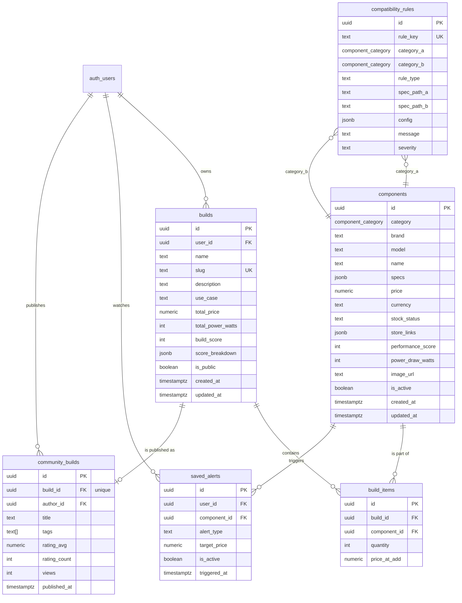

# Database — Nexus PC Builder

Postgres (Supabase) schema for the AI-Powered PC Builder. Two migrations plus a
seed file cover the whole Phase 1 data model:

| File                                         | Purpose                                                |
| -------------------------------------------- | ------------------------------------------------------ |
| `supabase/migrations/001_initial_schema.sql` | Enums, 6 tables, triggers, indexes, RLS, grants        |
| `supabase/migrations/002_catalogue_rls.sql`  | Role-scoped write policies for the catalogue           |
| `supabase/seed.sql`                          | 32 components, 12 compatibility rules, 3 public builds |

## Entity relationship diagram



## Tables

### `components` — the catalogue

One row per sellable part. `category` is the `component_category` enum
(`cpu | gpu | motherboard | ram | storage | psu | case | cooling`).

`specs` is category-specific JSONB. The compatibility engine reads these keys:

| Category      | Required spec keys                                                                 |
| ------------- | ---------------------------------------------------------------------------------- |
| `cpu`         | `socket`, `cores`, `threads`, `boostClock`, `tdp`, `ramType`, `integratedGraphics` |
| `gpu`         | `vram`, `tdp`, `length`, `recommendedPsu`, `slotWidth`, `powerConnectors`          |
| `motherboard` | `socket`, `chipset`, `formFactor`, `ramType`, `maxRam`, `ramSlots`, `m2Slots`      |
| `ram`         | `type`, `capacity`, `speed`, `casLatency`, `sticks`, `height`                      |
| `storage`     | `type`, `interface`, `capacity`, `readSpeed`, `writeSpeed`, `formFactor`           |
| `psu`         | `wattage`, `efficiency`, `modular`, `length`, `atxStandard`                        |
| `case`        | `formFactorSupport[]`, `maxGpuLength`, `maxCoolerHeight`, `radiatorSupport[]`      |
| `cooling`     | `type`, `tdpRating`, `socketSupport[]`, `height`, `radiatorSize`                   |

Indexes: partial index on `category` (active rows), GIN on `specs`, partial on
`price`. `updated_at` is maintained by the `set_updated_at()` trigger.

### `compatibility_rules` — declarative checks

`rule_type` is one of `match | min | max | formfactor | custom`, with
`spec_path_a` / `spec_path_b` pointing into each category's `specs` and `config`
holding extra parameters (e.g. `{"headroomPercent": 15}`). `severity` is
`error` (blocks adding a part) or `warning` (renders a `CompatibilityBadge`
amber). Seeded rule keys:

| rule_key                        | Meaning                                               |
| ------------------------------- | ----------------------------------------------------- |
| `cpu_motherboard_socket`        | CPU socket must match board socket                    |
| `cpu_ram_type`                  | CPU memory controller must support the RAM generation |
| `motherboard_ram_type`          | Board only accepts its designed DDR generation        |
| `ram_capacity_max`              | Total kit capacity ≤ board `maxRam`                   |
| `gpu_case_length`               | GPU length ≤ case `maxGpuLength`                      |
| `cooling_case_height`           | Air cooler height ≤ case `maxCoolerHeight`            |
| `cooling_socket_support`        | Cooler ships a bracket for the CPU socket             |
| `psu_wattage_min`               | PSU ≥ GPU `recommendedPsu` + headroom                 |
| `psu_gpu_connectors`            | PSU exposes the GPU's PCIe connectors (warning)       |
| `case_motherboard_formfactor`   | Board form factor supported by case                   |
| `motherboard_case_pcie`         | Long GPU may cover expansion slots (warning)          |
| `storage_motherboard_interface` | M.2 slot availability (warning)                       |

### `builds`

A saved configuration. `slug` is globally unique and powers `/b/:slug`.
`build_score` (0–100) and `score_breakdown` are written by the Phase 2 engine;
`total_price` and `total_power_watts` are always derived (see triggers).

### `build_items`

Join between a build and its components, one row per component
(`unique(build_id, component_id)`). `price_at_add` freezes the price so a saved
build's total doesn't silently drift.

### `saved_alerts`

Per-user price-drop / restock watches on a component. Unique on
`(user_id, component_id, alert_type)` so a user can't stack duplicate alerts.

### `community_builds`

Publishing record for a build (1:1 with `builds`). Holds presentation data:
title, tags (`text[]`, GIN indexed), rating aggregate and view counter.

## Triggers

| Trigger                     | Table         | Effect                                                                                                                            |
| --------------------------- | ------------- | --------------------------------------------------------------------------------------------------------------------------------- |
| `trg_components_updated_at` | `components`  | `set_updated_at()` on UPDATE                                                                                                      |
| `trg_builds_updated_at`     | `builds`      | `set_updated_at()` on UPDATE                                                                                                      |
| `trg_build_items_totals`    | `build_items` | `recalculate_build_totals()` — recomputes `builds.total_price` and `builds.total_power_watts` after any item insert/update/delete |

## Row Level Security

RLS is enabled on **every** table in `public`.

| Table                 | `anon` / `authenticated` SELECT           | Writes                                                            |
| --------------------- | ----------------------------------------- | ----------------------------------------------------------------- |
| `components`          | all rows                                  | `app_metadata.role ∈ (admin, catalog_editor)` — or `service_role` |
| `compatibility_rules` | all rows                                  | same as above                                                     |
| `builds`              | owner rows + rows with `is_public = true` | owner only (`auth.uid() = user_id`)                               |
| `build_items`         | rows whose parent build is readable       | owner of the parent build                                         |
| `saved_alerts`        | owner only                                | owner only                                                        |
| `community_builds`    | all rows                                  | owner (`auth.uid() = author_id`)                                  |

Helper function `public.is_catalogue_editor()` reads
`auth.jwt() -> 'app_metadata' ->> 'role'`. Grant that claim from the Auth API /
Dashboard for back-office accounts. Seeding runs through the SQL editor or
`service_role`, both of which bypass RLS.

## Applying the schema

**Local (recommended for development)**

```bash
supabase start                 # local Postgres + Studio + Auth
supabase db reset              # applies migrations 001 → 002, then seed.sql
```

**Hosted project**

```bash
supabase link --project-ref <your-project-ref>
supabase db push               # applies new migrations only
```

then paste `supabase/seed.sql` into the dashboard SQL editor (or run
`psql "$DATABASE_URL" -f supabase/seed.sql`).

## Verifying the seed

```sql
select count(*) from public.components;                                  -- 32
select category, count(*) from public.components group by 1 order by 1;  -- 6,6,4,4,3,3,3,3
select slug, total_price, total_power_watts from public.builds order by slug;
```

## Regenerating TypeScript types

The client is typed against `src/types/database.ts`, hand-written in the shape
the Supabase generator produces. After a schema change run:

```bash
supabase gen types typescript --project-id <ref> > src/types/database.ts
```

…and keep the camelCase mapping in `src/services/componentsService.ts` in sync.
